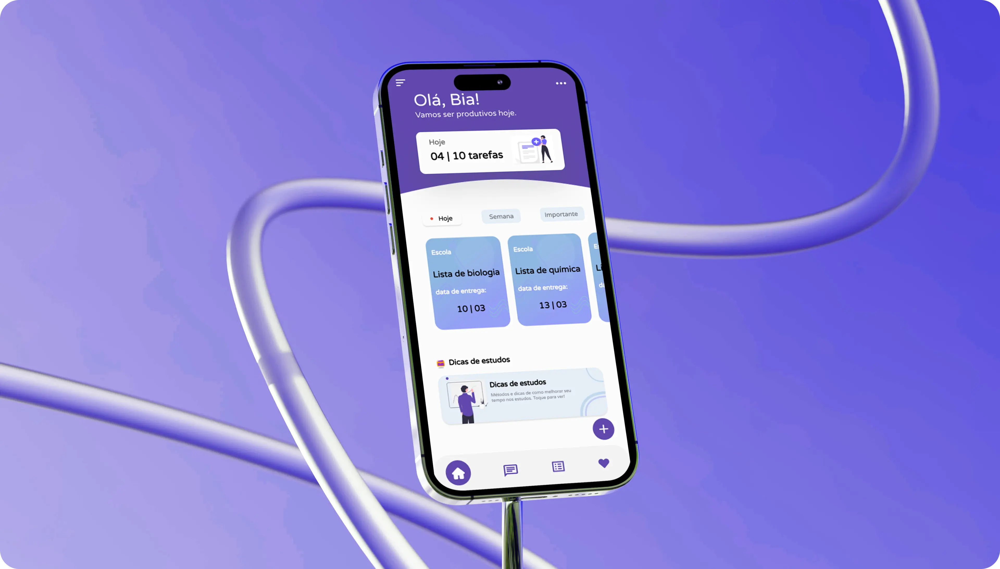
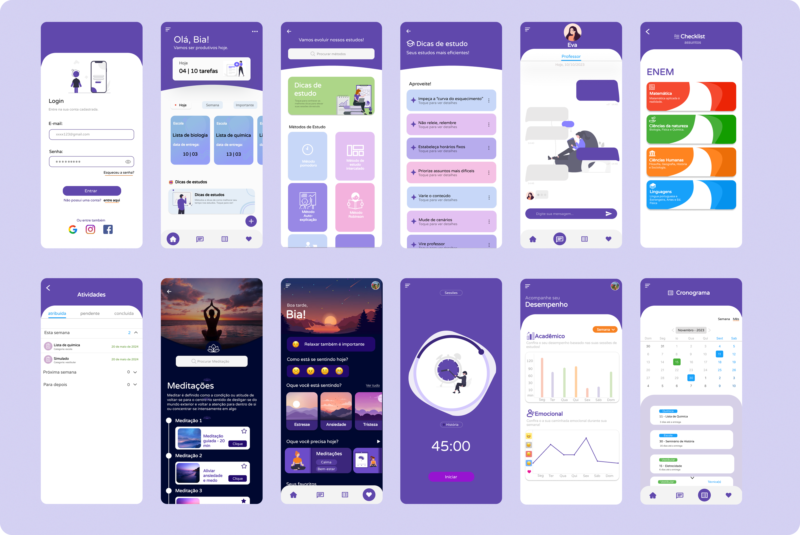

<div align="center">



# studUs

**Aplicativo mobile para ajudar estudantes do Ensino Médio a organizar os estudos, gerenciar o tempo e cuidar do bem-estar emocional.**


</div>

---

## Sobre o projeto

O **studUs** reúne produtividade e equilíbrio emocional em um só lugar. A proposta é oferecer uma experiência simples, motivadora e acolhedora para estudantes do Ensino Médio, com ferramentas de organização de estudos e de apoio ao bem-estar.

Este repositório contém o **front end** (aplicativo mobile). A API, construída com **NestJS**, está em [Vithor-jr/Studus_BackEnd](https://github.com/Vithor-jr/Studus_BackEnd).

## Funcionalidades

- ✅ Login e autenticação
- ✅ Tela inicial com visão geral dos estudos
- ✅ Métodos e dicas de estudo
- ✅ Atividades e organização por calendário
- ✅ Temporizador de estudo
- ✅ Gráficos de acompanhamento
- ✅ Meditações
- ✅ Acompanhamento do estado emocional
- ✅ Chat

## Telas

<div align="center">
  
</div>

## Tecnologias

| Área | Tecnologias |
| --- | --- |
| Base | [React Native](https://reactnative.dev/) 0.76, [Expo](https://expo.dev/) 52, JavaScript |
| Navegação | React Navigation (stack, bottom tabs, drawer e material top tabs) |
| Interface | Expo Linear Gradient, React Native SVG, Reanimated, Gesture Handler, Vector Icons, fonte Varela Round |
| Dados e gráficos | Axios, AsyncStorage, React Native Chart Kit, Gifted Charts |
| Calendário e datas | React Native Calendars, Calendar Strip, date-fns, Moment |
| Chat | React Native Gifted Chat e  GPT 3.5|
| Build | EAS Build |

## Como executar

### Pré-requisitos

- [Node.js](https://nodejs.org/) (versão LTS)
- [Expo Go](https://expo.dev/go) no celular, ou um emulador Android/iOS
- A [API do studUs](https://github.com/Vithor-jr/Studus_BackEnd) em execução

### Passo a passo

```bash
# 1. Clone o repositório
git clone https://github.com/Vithor-jr/studUs.git
cd studUs

# 2. Instale as dependências
npm install

# 3. Configure o endereço da API
#    [indique aqui onde fica a URL da API no código, ex.: src/services/api.js]

# 4. Inicie o projeto
npx expo start
```

Escaneie o QR code com o Expo Go

> O celular e o computador devem estar na mesma rede para o app alcançar a API local.

## Estrutura do projeto

```
studUs/
├── assets/      # imagens, ícones e fontes
├── src/         # telas, componentes, serviços, rotas...
├── App.js       # ponto de entrada
├── app.json     # configuração do Expo
└── eas.json     # configuração de build (EAS)
```

## Equipe Studus

| Nome | Papel |
| --- | --- |
| **Vithor Vitório** | Desenvolvedor (front end e back end) |
| **Cecília Costa** | Design / Projetista (UX/UI) |
| **Silvana Benchimol** | Analista de Sistemas |

O estudo de caso de UX/UI está no portfólio de Cecília: [studUs](https://cecilia-three.vercel.app/ux-ui-design/studus).


## Autor

**Vithor Vitório**
[Portfólio](https://vithor.vercel.app) · [LinkedIn](https://www.linkedin.com/in/vithor-vit%C3%B3rio-63887b2a6) · [GitHub](https://github.com/Vithor-jr)
